# Apex Coders Knowledge Handover Platform
### CodeFrontier Hackathon Round 2 — Final Submission Dossier

**Team APEX CODERS (VIT Pune)**
- **Aayush Patil** — Team Lead & Frontend Architect (UI/UX systems, Active Theory cyber-luxe design, triage client state, citation anchoring)
- **Omkar Patil** — Backend & Data Lead (FastAPI services, deterministic NLP extraction, persistence repository, conflict resolution engine)

---

## 1. Executive Summary & Core Innovation

Engineering transitions are notoriously brittle: when an engineer departs, institutional memory vanishes into undocumented slack threads, vague meeting notes, and unverified assumptions. Existing AI summarization tools hallucinate unsupported claims without citations, creating technical debt.

**The Apex Coders Knowledge Handover Platform** introduces a **deterministic, evidence-linked transition engine**:
1. **Zero-Hallucination Extraction**: Every reconstructed claim (Decision, Blocker, Next Action) is immutably anchored to exact quote snippets, line sections, and source filenames.
2. **Automated Conflict & Contradiction Engine**: Parses milestone dates, code freeze deadlines, and deployment targets across disparate documents to detect conflicting delivery timelines before handoff.
3. **Human-in-the-Loop Reviewer Gate**: Engineering leads triage claims, redact private credentials (API keys, secrets), and batch-approve verified facts.
4. **Sanitized Successor Brief**: Incoming engineers receive an actionable Day 1–30 continuation checklist with interactive completion tracking, free from noise and private credentials.
5. **Dual Deliverables**: Generates structured Markdown (`handover-brief.md`) and machine-readable audit logs (`handover-audit.json`) with cryptographic confidence scores.

---

## 2. Architecture & Pipeline Data Flow

```mermaid
flowchart LR
    A["Raw Sources\n(ADRs, Meeting Notes, Sprint Tasks)"] --> B["Deterministic Claim Extractor\n(Token/Regex & Pattern Parser)"]
    B --> C["Contradiction Engine\n(Freeze vs Launch Milestones)"]
    C --> D["Storage & Session Repository\n(saved_handovers.json / In-Memory)"]
    D --> E["Lead Reviewer Studio\n(Triage, Citation Anchoring, Redaction)"]
    E --> F["Lock Handover Gate\n(Sanitization & Validation)"]
    F --> G["Successor Day-1 View\n(Interactive Checklist & Progress Bar)"]
    G --> H["Export Engine\n(handover-brief.md + handover-audit.json)"]
```



### ASCII Architecture Schematic
```
[Raw Sources: ADRs / Logs] 
         │
         ▼
[Deterministic Regex/NLP Claim Extractor]
         │
         ├──► [Conflict & Contradiction Engine] ──► Flags date/scope mismatch (Neon Rose)
         │
         ▼
[Lead Reviewer Triage Studio] ───────────────► Approve / Edit / Redact credentials
         │
         ▼ (LOCK_HANDOVER)
[Successor Day-1 View] ─────────────────────► Sanitized Action Checklist (Cerulean Blue)
         │
         ├──► handover-brief.md (Human-readable successor transition guide)
         └──► handover-audit.json (Machine-readable compliance & confidence audit)
```

---

## 3. Technology Stack

- **Frontend**: React 18, Vite 5, Tailwind CSS, Lucide Icons.
- **Design System**: Active Theory Cybernetic Laboratory aesthetic (True Jet Black `#000000`, Cerulean Blue `#00F0FF`, Neon Rose `#FF007F`, hairline wireframe borders).
- **Backend**: FastAPI (Python 3.11+), Pydantic v2 schemas (`use_enum_values=True`), Uvicorn ASGI server.
- **Persistence**: JSON-backed state repository with in-memory cache (`backend/data/saved_handovers.json`).
- **Extraction**: Deterministic heuristic engine with regex milestone parsing + optional Gemini Flash 2.5 API integration.

---

## 4. Key Feature Matrix

| Feature | Implementation | Business Value |
|---|---|---|
| **Citation Traceability** | Bidirectional anchor links from claim to raw file snippet | Zero hallucinations; auditable proof for every handover statement. |
| **Conflict Detection** | Cross-document timeline reconciliation (e.g. Nov 10 freeze vs Nov 15 launch) | Prevents shipping conflicting schedules and broken release dates. |
| **Credential Redaction** | Regex pattern matching for API keys (`ghp_`, `AKIA`, Bearer tokens) | Prevents leaking credentials in downstream successor packages. |
| **Judge Demo Presets** | Dropdown for Preset 1 (Conflict) and Preset 2 (Clean Auth) | Instant one-click evaluation without typing. |
| **60s Guided Tour** | Interactive 4-step stepper walkthrough in Header | Judges can inspect the core value proposition in under 1 minute. |
| **Successor Checklist** | Interactive task checkboxes with animated Cerulean progress bar | Smooth day-one continuation for incoming engineers. |
| **Dual Export** | Handover Brief (`.md`) + Audit Trail (`.json`) | Seamless export for both humans and compliance pipelines. |

---

## 5. Quickstart Guide (Local Execution)

### Automated Windows Launcher:
Double-click `run_app.bat` in the project root.

### Manual Launch Commands:

**1. Start the FastAPI Backend:**
```powershell
cd backend
python -m uvicorn app.main:app --host 127.0.0.1 --port 8000 --reload
```
- API Health Check: `http://127.0.0.1:8000/api/health`
- Swagger Interactive Docs: `http://127.0.0.1:8000/docs`

**2. Start the React Frontend:**
```powershell
cd frontend
npm run dev
```
- Web Application: `http://localhost:5173`

---

## 6. How Judges Can Evaluate the Platform in 2 Minutes

1. Open `http://localhost:5173`.
2. Notice the **Landing & Team Dossier Showcase** explaining the institutional knowledge problem.
3. Click **[ ⚡ Try Live Demo ]** or click **[ ⚡ 60s_JUDGE_TOUR ]** in the top navigation bar.
4. **Step 1**: Click **[ VIEW CITATION ]** on Claim 1 to see the source citation highlight in the left panel.
5. **Step 2**: Inspect the **Neon Rose CONFLICT** badge on Claim 3 showing the Nov 10 freeze vs Nov 15 launch conflict.
6. **Step 3**: Click **[ REDACT ]** on a claim to conceal sensitive information.
7. **Step 4**: Switch to **SUCCESSOR_VIEW** to view the clean, sanitized Day-1 checklist.
8. Click the interactive checklist checkboxes to see the Cerulean Blue progress bar animate to 100%.
9. Click **EXPORT (.MD)** and **AUDIT (.JSON)** to download the production-ready transition deliverables.
10. Use the **⚡ Scenario Presets** dropdown to switch to **PRESET 2: Clean Auth (Verified)**.

---
*Team APEX CODERS — CodeFrontier Hackathon Round 2*

